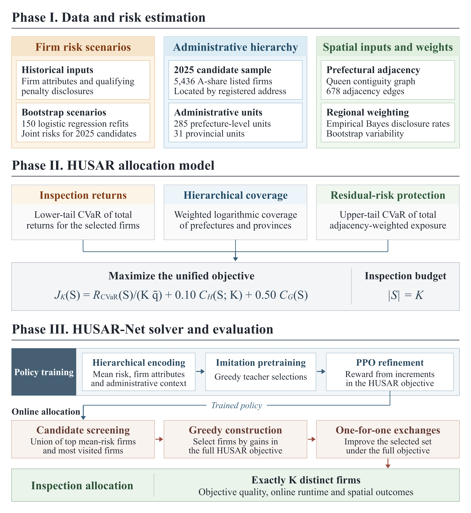
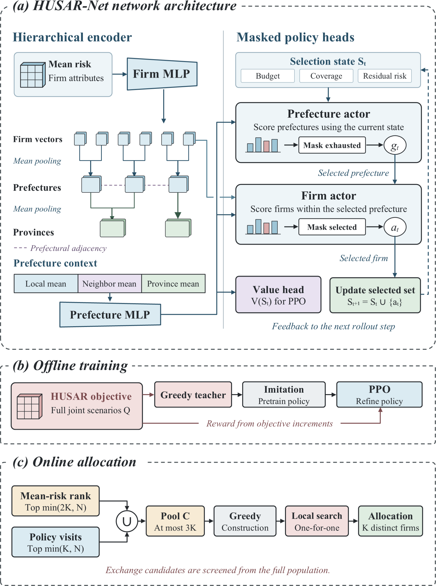

# HUSAR-Net

HUSAR-Net selects a fixed number of candidates across a two-level geographic hierarchy. It uses joint risk scenarios to balance conservative returns, regional coverage, and the concentration of residual risk among neighbouring regions.

The policy screens candidates by mean risk and hierarchical context. Greedy construction and local exchanges then score the selected set with the full scenario-based HUSAR objective.

## Install and run

Use Python 3.10 or later. From the repository directory, install the package and run the synthetic example.

```powershell
python -m pip install .
husarnet demo
```

The demo prints a JSON allocation containing 12 distinct candidate indices, the objective and its three components, and the size of the candidate pool. It runs on CPU using the bundled policy trained on synthetic instances with 1,000 candidates and a budget of 50.

## Datasets

The [data directory](data/) contains the study datasets in NPZ format.

- [Real-world dataset](data/real/real_2025.npz) with 5,436 listed firms, two sets of risk scenarios, and retrospective disclosure labels.
- [Synthetic datasets](data/synthetic/instances.csv) with 260 training, validation, and test instances across five scales.

```powershell
husarnet solve data/real/real_2025.npz
husarnet solve data/synthetic/main_test/n1000/seed_880000.npz
```

See the [data guide](data/README.md) for the fields, study budgets, and instance splits.

## Allocate with your own data

The Python API accepts NumPy arrays or array-like inputs. Candidate and region indices start at zero. The selected indices refer to rows of the risk matrix in the order you supplied.

```python
from husarnet import Instance, load_example_policy, solve

instance = Instance(
    q=[[0.8, 0.7, 0.9], [0.3, 0.5, 0.4], [0.7, 0.5, 0.6], [0.2, 0.4, 0.3]],
    city=[0, 0, 1, 1],
    prov=[0, 0, 1, 1],
    city_prov=[0, 1],
    edges=[[0, 1]],
    K=2,
)

policy = load_example_policy()
allocation = solve(instance, policy, seed=5100)
print(allocation.selected)
print(allocation.objective)
```

| Input | Meaning |
| --- | --- |
| `q` | An `N × B` matrix of finite, nonnegative risks with a positive overall mean. Each column is one joint scenario shared by all candidates. |
| `city`, `prov` | Length-`N` arrays of prefecture and province indices. At each level, indices are contiguous and every region contains candidates. |
| `city_prov` | Length-`G` array mapping each of the `G` prefectures to its province. It must agree with `prov` for every candidate. |
| `edges` | At least one pair of adjacent prefectures. List each undirected edge once. |
| `K` | Allocation budget, between 1 and `N` inclusive. |
| `rho`, `a_city`, `a_prov` | Optional positive historical prefecture risks and prefecture and province coverage weights. Each defaults to ones. |

The optional objective coefficients `alpha` and `beta` default to `0.10` for hierarchical coverage and `0.50` for spatial protection. Both CVaR tails use a probability mass of `0.25`. The coverage levels are equally weighted. Use `instance.evaluate(selected)` to evaluate another set of `K` distinct candidates.

For command-line use, save these fields to an NPZ file with `save_instance(instance, path)` or `numpy.savez`. The following commands create an example file and solve it.

```powershell
husarnet example --output outputs/example.npz
husarnet solve outputs/example.npz --output outputs/allocation.json
```

Pass `--checkpoint path/to/policy.pt` to use a trained policy. `--swap-seconds` controls the soft time limit of the local exchange stage. A value of zero returns the greedy solution within the policy-screened candidate pool.

## Train a policy

Train on instances representative of the region structure, risk scenarios, and budgets in your application. Supply separate training and validation instances in the same NPZ format. The example below runs one epoch of imitation learning and one PPO round.

```powershell
husarnet example --seed 101 --output outputs/train.npz
husarnet example --seed 102 --output outputs/validation.npz
husarnet train --training outputs/train.npz --validation outputs/validation.npz --imitation-epochs 1 --ppo-rounds 1 --output outputs/policy.pt
husarnet solve outputs/example.npz --checkpoint outputs/policy.pt
```

For Python workflows, use `train_policy(training, validation)`, `save_policy(policy, path)`, and `load_policy(path)`. Teachers are generated by greedy construction under the HUSAR objective. PPO uses changes in that objective as rewards.

## Method diagrams



*HUSAR framework.*



*HUSAR-Net architecture.*

## Development

```powershell
python -m pip install ".[test]"
python -m pytest
```

This implementation accompanies the manuscript *Hierarchical spatial resource allocation under uncertainty: A deep reinforcement learning-guided optimization approach*. The HUSAR-Net software uses the [MIT License](LICENSE).
